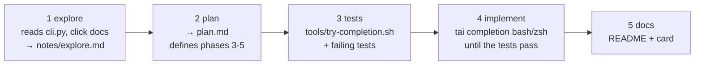
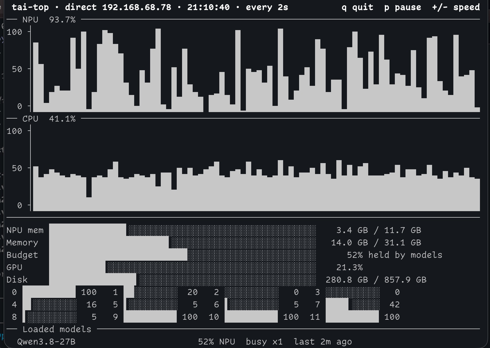
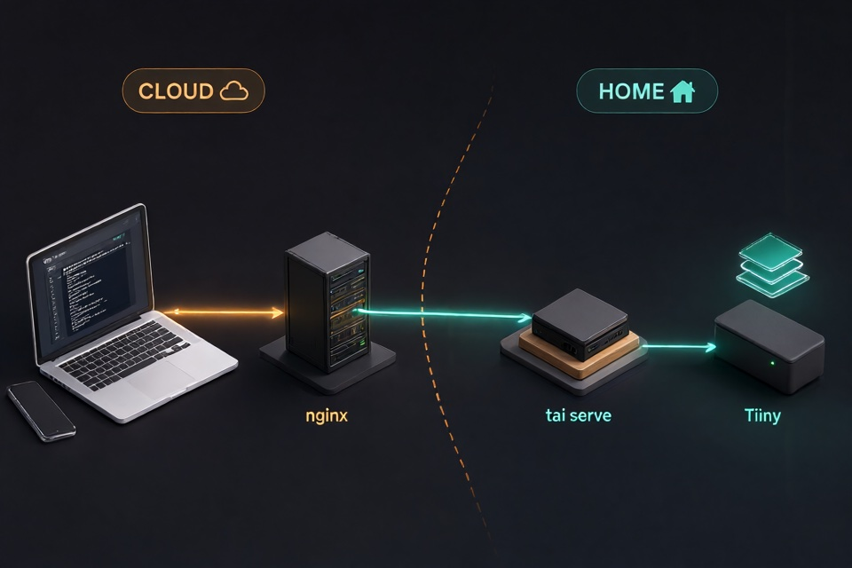

[](https://github.com/epatel/tiiny-cli/actions/workflows/ci.yml)
[](https://github.com/epatel/tiiny-cli/actions/workflows/audit.yml)
[](https://scorecard.dev/viewer/?uri=github.com/epatel/tiiny-cli)

<a href="https://claude.ai"></a>

# tai

Use every model on your [Tiiny](https://www.tiiny.ai/) from the terminal, over Wi-Fi.

```
$ tai models
    Name                   Type                Task  Params     Size  NPU  Context  Model ID
 ○  Qwen3-ASR-1.7B         ASR                 asr     1.7B   4.6 GB   8%           Qwen/Qwen3-ASR-1.7B
 ○  Qwen3.8-27B            Image-Text-to-Text  chat     27B  15.9 GB  52%     262K  Qwen/Qwen3.8-27B
 ●  Qwen3.6-35B-A3B-Turbo  Image-Text-to-Text  chat     35B  17.7 GB  46%     262K  Qwen/Qwen3.6-35B-A3B-Turbo
 ○  TRELLIS.2-4B           Image-to-3D         3d        4B   9.8 GB   6%           microsoft/TRELLIS.2-4B
 ...
```

The device only runs *loaded* models, and they share an NPU budget. `tai` loads whatever a command needs. When it doesn't fit, it picks the idle models that free the least NPU (so big models stay loaded), shows them, and asks. Pass `-y` to skip the prompt.

## TL;DR

You need Python 3.10+, the device's IP address and its API key.

```sh
git clone https://github.com/epatel/tiiny-cli && cd tiiny-cli
make setup                    # .venv + tai (add PYTHON=python3.12 if python3 is older than 3.10)
make link                     # tai on PATH via ~/.local/bin
```

Then tell `tai` the address and key, in one of two ways:

- **With the official `tiiny` CLI:** run `tiiny connect <device-ip>` and `tiiny login` once. `tai` reads both from `~/.local/tiiny/config.json`, so there is nothing else to set.
- **With the API key from the TiinyOS app:** put both in `~/.config/tai/.env` (used in every folder), or in a `.env` in the folder you run `tai` from:

  ```sh
  TAI_DEVICE=192.168.1.42       # the device's IP
  TIINY_API_KEY=<your key>
  ```

  Environment variables override the `.env` files.

```sh
tai models                    # what's installed and loaded, by type then size (--sort name)
tai ask "hello"               # loads a chat model if needed (asks before unloading others)
```

## Install

Requires Python 3.10 or newer. macOS ships 3.9 (`/usr/bin/python3`, from the Xcode Command Line Tools), so install a newer one first, e.g. `brew install python` or `uv python install 3.12`. `make setup` uses `python3` from your PATH. To pick another one, run `make setup PYTHON=python3.12`.

```sh
make setup   # creates .venv and installs tai into it
make link    # optional: symlink tai into ~/.local/bin (PREFIX=... to change)
```

`tai` reads the device address and auth key from the official `tiiny` CLI's config (`~/.local/tiiny/config.json`), so run `tiiny connect <ip>` and `tiiny login` once. To override, set `TAI_DEVICE`, or set the token with `TIINY_API_KEY` or `TAI_TOKEN`. Put them in the environment, in a `.env` file in the current directory, or in `~/.config/tai/.env` (applies everywhere); the environment wins, then the folder's `.env`.

## Usage

```sh
tai ask "explain RAII in two sentences"
git diff | tai ask -m coder "review this diff"
tai ask -f photo.jpg "what's in this picture?"   # vision model (Qwen3.6)
tai ask --think --show-thinking "hard puzzle…"   # toggle reasoning

tai chat                    # interactive; /help inside for commands
                            # /think hide shows a spinner instead of the reasoning text
tai chat -c                 # continue the last session
tai chat --no-save          # don't keep this session (also tai agent --no-save)
tai history                 # list sessions; `tai history show 3`, `tai history rm 3`
tai history clear           # delete all sessions and the agent's prompt history

tai image "a fox in the snow, watercolor" -o fox.png --size 1024x1024 --open
tai tts "Hello there" -i "female, british accent" --play
tai tts "Hej, hur mår du?" -x language=sv          # -x KEY=VALUE: any option tai has no flag for
tai tts "Good morning" --clone me.wav --clone-text "the words in me.wav"   # in your voice (Qwen3-VoiceClone; VibeVoice: -m vibevoice, no --clone-text)
tai asr recording.wav
tai embed "first text" "second text"           # JSON lines
tai 3d toy.png --faces 200000 -o toy.glb       # ~15 min, image → textured mesh
tai video "a fox in the snow" --seconds 2 --steps 4 --open   # clip with sound, ~7 min
tai video -i fox.png "the fox starts running"  # animate a start frame; max 7 s, 4 sizes

tai agent                   # coding agent (full-screen) in the current folder; see below
tai agent "fix the failing test"   # start with a task; -c continues here
tai mcp                     # MCP servers the agent uses (.mcp.json, ~/.config/tai/mcp.json)
tai skills                  # skills it can use (.claude/skills, ~/.claude/skills, ~/.config/tai/skills)

tai status                  # NPU usage, downloads in progress
tai usage                   # tokens and requests per day and model this week (-w 1: last week)
tai top                     # live full-screen view: NPU/CPU graphs, memory, models (q quits; --ascii for plain ASCII)
tai load qwen3.6            # pre-load; tai unload --all
tai download                # store models not on the device; tai download kokoro
tai update                  # models with a newer version in the store; tai update kokoro
tai rm kokoro               # delete a model from the device (asks first)
tai info omni               # what a model is (incl. context window) + the options it reports (--json, --no-load)
tai config set default.chat coder              # preferred model per task
tai config set think off                       # default reasoning mode
tai config set agent.think off                 # the same for tai agent only (also: tai agent --no-think)
tai config set agent.compact 70                # tai agent compacts at 70% of the context (default 85; off)
tai config set agent.max_steps 400             # model calls per tai agent turn before it pauses (default 200; off)
tai config set agent.recheck off               # skip the requirements check before a turn ends (default on)
tai config set show_thinking off               # tai chat: hide the reasoning text by default
```

Models can be named by full id, display name, or any unique part of either (`coder`, `z-image`, `omni`).

`-x KEY=VALUE` (repeatable) sends a field tai has no flag for: in the request body for `ask`,
`chat`, `image` and `embed`, inside `config` for `tts`, as a form field for `asr`. `a.b=1`
nests, and values are JSON when they parse (`temperature=0.2`, `stop='["\n"]'`), else text.
`tai info MODEL` shows what a model reports it accepts (OmniVoice lists its
`supported_languages`). tai doesn't check the fields; the device decides, and some (like
an unknown language) it accepts silently.

```bash
tai tts "Hej, hur mår du?" -x language=sv -i "female, low pitch"    # Swedish voice
tai ask -x max_tokens=50 "Summarise this" < notes.txt                 # cap the answer length
tai ask -x 'stop=["\n\n"]' "One paragraph about otters"               # stop at a blank line
tai ask -x response_format.type=json_object "Name and age of a fictional person, as JSON"
tai embed -x dimensions=256 "hello"                                   # 256 numbers instead of 1024
```

All five were checked on the device (Qwen3.6, OmniVoice, Qwen3-Embedding).

## The coding agent: `tai agent`

A full-screen coding agent that works in the current folder, on any installed model that supports tool use (e.g. Qwen3-Coder-Next or Qwen3.6; `tai config set default.agent …` picks one). It reads, searches and edits files, runs commands, makes images and video clips, and searches the web. It reads the project's `AGENTS.md` or `CLAUDE.md`.

```sh
tai agent                          # new session in this folder
tai agent "fix the failing test"   # start with a task
tai agent -c                       # continue the latest session here (-r ID: any session)
tai agent -m qwen3.6 --no-think    # pick the model, reasoning off
tai agent --no-save                # leave no session or prompt history behind
tai agent --phase "add shell completion"   # phased work on a larger task (below)
```

**Permissions.** Reading never asks. Edits show a diff and commands show the command line before they run: **y** yes, **a** always (this session), **n** no. Web searches and page fetches ask too. Writes outside the project ask every time.

**Inside the agent**

| Command | What it does |
|---|---|
| `/phase start <goal>` | Phased work on a larger task (below). `/phase` shows the phases; `/phase help` lists the rest |
| `/compact [focus]` | Summarise the conversation to free context; the focus says what to keep in detail |
| `/think on\|off` | Reasoning on or off from the next step |
| `/recheck on\|off` | The requirements check before a turn ends, for this run |
| `/tiiny status\|models\|load\|unload\|restart\|shutdown` | Manage the device without leaving the agent |
| `/view` | Open the browser viewer (images, audio, video, 3D, HTML, and questions from the agent) |
| `/skills`, `/<skill> [task]` | List skills, or use one |
| `/mcp` | MCP servers and their tools |
| `/clear`, `/help`, `/exit` | Forget the conversation, show keys and commands, quit |

Enter sends; Ctrl+J, Alt+Enter or `\` then Enter adds a new line. ↑/↓ recall earlier prompts. Esc interrupts. The status line shows what the agent is doing and how full the context is (e.g. `13K / 131K tokens (10%)`).

**Phased work.** `/phase start <goal>` (or `tai agent --phase "<goal>"`) splits a larger task into focused phases. If you give the agent a big task as a normal prompt, it may offer to switch to phased work itself; you're asked first, and the conversation so far is passed on as background. Each phase starts with a fresh context, so it can use the whole context window for one thing. The first two are fixed: **explore** (read the code, write notes) and **plan** (write `plan.md` and define the remaining phases, e.g. build a test tool, write tests, implement, verify). Phases pass work on through files in `.tai/work/<date>-<task>/` (`plan.md`, `notes/`, `tools/`, `tests/`) and a short handoff; writing in that folder needs no permission. After each phase the agent asks whether to start the next one (**a** stops asking). If a phase fills 80% of the context it is told to write its notes and finish; at 95% it stops, and `/phase redo` restarts it fresh with its files kept. `/phase resume` continues the latest task in the folder, and `/phase stop` leaves phased mode. The work folder stays in the project, so you can read it or commit it.

<details>
<summary>Example: phased work on "add shell completion"</summary>

An illustration of the flow, not a recorded run. The phases after `plan` are whatever the plan decides.

```sh
tai agent --phase "add shell completion for bash and zsh, installed with tai completion"
```



1. **explore** reads `src/tai/cli.py`, the Makefile and click's completion docs (web search), and writes what it found to `notes/explore.md`: how commands are registered, that click already generates completion scripts, open questions. It changes no project files, then calls `phase_done` with a short handoff.
2. You're asked *Start phase plan now?* — **y**.
3. **plan** starts with a fresh context holding the task, explore's handoff and the notes it points to. It asks you one real choice (print the script, or also install it?), writes `plan.md` and defines the remaining phases.
4. **tests** writes `tools/try-completion.sh` (runs a completion in a scratch shell) and failing tests in `tests/`. Its handoff says how to run both.
5. **implement** adds `tai completion bash|zsh` until those tests pass. **docs** updates the README.

Each phase sees only the work folder and the handoffs, never the earlier conversations:

```text
.tai/work/2026-11-14-add-shell-completion-for-bash-and-zsh/
├── state.json          # goal, phases, handoffs (written by tai)
├── plan.md             # goal, approach, decisions, phases (written by the agent)
├── notes/explore.md
├── tools/try-completion.sh
└── tests/
```

`/phase` shows where it is (`✓ explore`, `✓ plan`, `▶ tests`, `· implement`, `· docs`), and the title bar shows `phase 3/5 · tests`.

</details>

**Compaction.** When the context reaches 85% (`tai config set agent.compact 70`, or `off`), the model summarises the conversation: task, decisions, what's done, current state, next steps. The conversation continues from that summary plus the latest messages. If it fails or you press Esc, nothing changes. The full conversation stays saved as its own session.

**Requirements check.** When a turn that changed files is about to end, the agent gets the task back as a numbered list of requirements, rereads its changes, marks each one ok or missing, and fixes what's missing. In benchmarks this cut missed explicit requirements (such as "round per line" or "call `clock.now()` through the module") from 5 of 9 runs to none, for about 20% more model calls. `/recheck off` or `tai config set agent.recheck off` turns it off.

**Step limit.** One prompt may lead to many model calls (read, edit, run, read again). After 200 calls in one turn the agent pauses with "step limit reached"; type `continue` to carry on in the same conversation. `tai config set agent.max_steps 400` changes the limit, and `off` removes it. Phased work has no step limit: the context budget ends each phase.

**Media and the viewer.** The agent can make images (`image` tool) and short video clips (`video`, several minutes each). Results, and questions with choices, open in a local browser page. When a model doesn't fit next to the agent's own, it asks before unloading anything and reloads the agent's model afterwards.

**MCP servers and skills.** MCP servers come from the project's `.mcp.json` (Claude Code's format) and `~/.config/tai/mcp.json`. Their tools ask first unless the server marks them read-only. Skills come from `.claude/skills/`, `~/.claude/skills/` and `~/.config/tai/skills/`, so they are shared with Claude Code. `tai mcp` and `tai skills` list them; `tai agent --no-mcp` skips MCP.

**`tai top`** shows the device live: NPU and CPU history, NPU memory, memory, the NPU budget held by models, GPU, disk, per-core load and the loaded models. `p` pauses, `+`/`-` change the refresh interval, `q` quits.



## Remote use: `tai serve`



One machine near the Tiiny runs the server; other machines use `tai` as usual through it.

```sh
tai serve --new-key                          # once: make a key
TAI_API_KEY=… tai serve --port 8798          # on the server (or TAI_SERVE_PORT; default 8765)
TAI_URL=https://host/tai TAI_API_KEY=… tai chat    # anywhere else (or --url; put both in ~/.config/tai/.env)
```

The server forwards the device API after checking the key, and never shares the device key. It listens on 127.0.0.1. Point nginx at it, e.g. `location /tai/ { proxy_pass http://127.0.0.1:8798; }`; the server ignores the `/tai` prefix by itself. Turn off buffering and raise timeouts for streaming and long jobs. See `cards/serve.md` for the snippet. Sessions and settings stay on each client. Because the server only forwards, a newer client normally works through an older server; `tai --version` on a client also shows the server's build.

## Development

```sh
make test    # unit tests (mocked, no device needed)
make check   # tests + code-health delta; run before committing
make help    # all targets
```

The benchmarks of `tai agent` (a harness that runs it headless on the device, graded tasks, and a blind Claude review of the results) are on the [`benchmarks`](../../tree/benchmarks) branch.

`tai --version` adds the build from git when tai runs from its checkout: `build 47 (9138ee6)`, the number of commits and the commit, plus `+ changes` when the tracked files differ from it.

See `CLAUDE.md` and `cards/` for how the device API works and how swapping is decided.

## License

[MIT](LICENSE)
