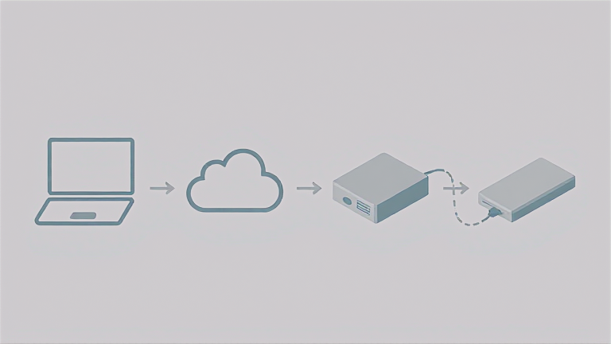

[](https://github.com/epatel/tiiny-cli/actions/workflows/ci.yml)
[](https://github.com/epatel/tiiny-cli/actions/workflows/audit.yml)
[](https://scorecard.dev/viewer/?uri=github.com/epatel/tiiny-cli)

<a href="https://claude.ai"></a>

# tai

Use every model on your [Tiiny](https://www.tiiny.ai/) from the terminal, over Wi-Fi.

```
$ tai models
    Name                  Task   Type                NPU  Context  Model ID
 ○  TRELLIS.2-4B          3d     Image-to-3D         6%            microsoft/TRELLIS.2-4B
 ○  Qwen3-ASR-1.7B        asr    ASR                 7%            Qwen/Qwen3-ASR-1.7B
 ●  Qwen3-Coder-Next      chat   Text Generation     94%  131K     Qwen/Qwen3-Coder-Next
 ○  Qwen3.6-35B-A3B       chat   Image-Text-to-Text  47%  262K     Qwen/Qwen3.6-35B-A3B
 ...
```

The device only runs *loaded* models, and they share an NPU budget. `tai` loads whatever a command needs. When it doesn't fit, it picks the idle models that free the least NPU (so big models stay loaded), shows them, and asks. Pass `-y` to skip the prompt.

## TL;DR

You need Python 3.10+ and the official `tiiny` CLI, already paired with your device.

```sh
git clone https://github.com/epatel/tiiny-cli && cd tiiny-cli
make setup                    # .venv + tai (add PYTHON=python3.12 if python3 is older than 3.10)
make link                     # tai on PATH via ~/.local/bin
tiiny connect <device-ip>     # once, if not done already: tai reuses this config
tiiny login
tai models                    # what's installed and loaded
tai ask "hello"               # loads a chat model if needed (asks before unloading others)
```

## Install

Requires Python 3.10 or newer. macOS ships 3.9 (`/usr/bin/python3`, from the Xcode Command Line Tools), so install a newer one first, e.g. `brew install python` or `uv python install 3.12`. `make setup` uses `python3` from your PATH. To pick another one, run `make setup PYTHON=python3.12`.

```sh
make setup   # creates .venv and installs tai into it
make link    # optional: symlink tai into ~/.local/bin (PREFIX=... to change)
```

`tai` reads the device address and auth key from the official `tiiny` CLI's config (`~/.local/tiiny/config.json`), so run `tiiny connect <ip>` and `tiiny login` once. To override, set `TAI_DEVICE`, or set the token with `TIINY_API_KEY` or `TAI_TOKEN`. Put them in the environment, in a `.env` file in the current directory, or in `~/.config/tai/.env` (applies everywhere); the environment wins, then the folder's `.env`.

## Usage

```sh
tai ask "explain RAII in two sentences"
git diff | tai ask -m coder "review this diff"
tai ask -f photo.jpg "what's in this picture?"   # vision model (Qwen3.6)
tai ask --think --show-thinking "hard puzzle…"   # toggle reasoning

tai chat                    # interactive; /help inside for commands
                            # /think hide shows a spinner instead of the reasoning text
tai chat -c                 # continue the last session
tai chat --no-save          # don't keep this session (also tai agent --no-save)
tai history                 # list sessions; `tai history show 3`, `tai history rm 3`
tai history clear           # delete all sessions and the agent's prompt history

tai image "a fox in the snow, watercolor" -o fox.png --size 1024x1024 --open
tai tts "Hello there" -i "female, british accent" --play
tai tts "Hej, hur mår du?" -x language=sv          # -x KEY=VALUE: any option tai has no flag for
tai asr recording.wav
tai embed "first text" "second text"           # JSON lines
tai 3d toy.png --faces 200000 -o toy.glb       # ~15 min, image → textured mesh
tai video "a fox in the snow" --seconds 2 --steps 4 --open   # clip with sound, ~7 min
tai video -i fox.png "the fox starts running"  # animate a start frame; max 7 s, 4 sizes

tai agent                   # coding agent (full-screen) in the current folder
tai agent "fix the failing test"   # start with a task; -c continues here
                            # inside: /tiiny status|models|load|unload|restart|shutdown, /view, /think on|off
                            # makes images and video clips; media and questions open in a browser viewer
                            # searches the web (DuckDuckGo) and reads pages; asks first, `a` allows both
                            # the status line shows how full the context is (e.g. 13K / 131K tokens)
tai mcp                     # MCP servers the agent uses (.mcp.json, ~/.config/tai/mcp.json)
tai skills                  # skills it can use (.claude/skills, ~/.claude/skills, ~/.config/tai/skills)

tai status                  # NPU usage
tai load qwen3.6            # pre-load; tai unload --all
tai info omni               # what a model is (incl. context window) + the options it reports (--json, --no-load)
tai config set default.chat coder              # preferred model per task
tai config set think off                       # default reasoning mode
tai config set agent.think off                 # the same for tai agent only (also: tai agent --no-think)
tai config set show_thinking off               # tai chat: hide the reasoning text by default
```

Models can be named by full id, display name, or any unique part of either (`coder`, `z-image`, `omni`).

`-x KEY=VALUE` (repeatable) sends a field tai has no flag for: in the request body for `ask`,
`chat`, `image` and `embed`, inside `config` for `tts`, as a form field for `asr`. `a.b=1`
nests, and values are JSON when they parse (`temperature=0.2`, `stop='["\n"]'`), else text.
`tai info MODEL` shows what a model reports it accepts (OmniVoice lists its
`supported_languages`). tai doesn't check the fields; the device decides, and some (like
an unknown language) it accepts silently.

```bash
tai tts "Hej, hur mår du?" -x language=sv -i "female, low pitch"    # Swedish voice
tai ask -x max_tokens=50 "Summarise this" < notes.txt                 # cap the answer length
tai ask -x 'stop=["\n\n"]' "One paragraph about otters"               # stop at a blank line
tai ask -x response_format.type=json_object "Name and age of a fictional person, as JSON"
tai embed -x dimensions=256 "hello"                                   # 256 numbers instead of 1024
```

All five were checked on the device (Qwen3.6, OmniVoice, Qwen3-Embedding).

## Remote use: `tai serve`



One machine near the Tiiny runs the server; other machines use `tai` as usual through it.

```sh
tai serve --new-key                          # once: make a key
TAI_API_KEY=… tai serve --port 8798          # on the server (or TAI_SERVE_PORT; default 8765)
TAI_URL=https://host/tai TAI_API_KEY=… tai chat    # anywhere else (or --url; put both in ~/.config/tai/.env)
```

The server forwards the device API after checking the key, and never shares the device key. It listens on 127.0.0.1. Point nginx at it, e.g. `location /tai/ { proxy_pass http://127.0.0.1:8798; }`; the server ignores the `/tai` prefix by itself. Turn off buffering and raise timeouts for streaming and long jobs. See `cards/serve.md` for the snippet. Sessions and settings stay on each client. Because the server only forwards, a newer client normally works through an older server; `tai --version` on a client also shows the server's build.

## Development

```sh
make test    # unit tests (mocked, no device needed)
make check   # tests + code-health delta; run before committing
make help    # all targets
```

`tai --version` adds the build from git when tai runs from its checkout: `build 47 (9138ee6)`, the number of commits and the commit, plus `+ changes` when the tracked files differ from it.

See `CLAUDE.md` and `cards/` for how the device API works and how swapping is decided.

## License

[MIT](LICENSE)
