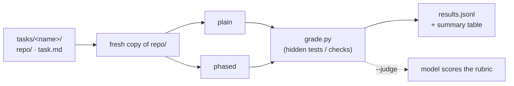

# Benchmarks: `tai agent` with and without phased work

Runs the same tasks through `tai agent`'s loop in two modes on your Tiiny device, then grades the results:

- **plain**: one prompt, one conversation, as you would type it. It compacts at 85% and gets up to two "continue" nudges if it hits the step limit.
- **phased**: the same prompt as the goal of `/phase start`. It runs explore → plan → the phases the plan defines, each with a fresh context, with the gates answered "yes".



## Running

```sh
.venv/bin/python benchmarks/run.py --check                       # graders only: no device, ~10 s
.venv/bin/python benchmarks/run.py                               # all tasks, both modes, 1 run each
.venv/bin/python benchmarks/run.py -t ts-templates -n 3          # one task, 3 runs per mode
.venv/bin/python benchmarks/run.py --mode phased --judge         # phased only, plus the model judge
.venv/bin/python benchmarks/run.py --report ~/.local/share/tai/bench/20261114-2130
```

- **Time:** a run can take a long time: tens of minutes per task and mode on the device. `--timeout` (minutes, default 60) cancels a run that takes longer.
- **Results:** each run's repo, including phased work's `.tai/work/` folder, is kept under `~/.local/share/tai/bench/<time>/<task>/<mode>-<n>/`. Results are appended to `results.jsonl` as each run finishes, so an interrupted benchmark keeps what it has.
- **Models:** the agent model is loaded if needed. Like `tai agent`, it asks before unloading other models (`-y` skips the question).
- **Settings:** the model and thinking settings are the same as `tai agent`'s (`default.agent`, `agent.think`), and `-m` picks another model.

## Reading the summary

| column | meaning |
|---|---|
| score | mean share of the grader's checks passed (hidden tests for code; rules and answers for writing and research) |
| range | worst and best run |
| judge | mean rubric score 1–10 from `--judge` (writing and research only) |
| tokens | prompt + completion tokens over all requests. Prompt tokens are counted per request, so the cache is ignored |
| requests, minutes | model calls and wall-clock time |

Device output varies from run to run, so use `-n 3` or more before drawing conclusions. The judge is the same model that did the work: use it to compare the two modes, not as an absolute score.

## Tasks

| task | domain | what it measures |
|---|---|---|
| `python-inventory` | Python | Add expiring reservations across models, store, CLI and a clock seam. 17 hidden pytest tests, plus the project's own tests kept and extended. |
| `ts-templates` | TypeScript (Node, no deps) | Grow a variables-only template engine into if/each/partials with scopes, `../` paths, and errors with line numbers. 20 hidden `node --test` tests. |
| `research-rail` | research | 12 questions from 11 conflicting documents about a made-up railway, where corrections supersede earlier figures and an interview misleads. Graded on answers and cited files, plus a briefing (also judged). |
| `writing-story` | writing | A five-chapter story from a brief. The grader checks lengths, the required sentence, the compass, the cast and repeated sentences. The judge rates plot, consistency, the reveal, characters and prose. |

Each task folder holds:
- `task.md`: the prompt, given word for word to both modes;
- `task.json`: the domain, `hidden_tests` (the denominator, so tests that fail to import still count) and an optional judge rubric;
- `repo/`: the starting project;
- `hidden/` (optional): tests installed only after the agent is done;
- `grade.py`: prints `{"passed", "total", "notes"}`, using helpers from `grading.py`;
- `solution/` or `make_solution.py`: a reference answer, so `--check` proves the grader gives it 100% and the untouched repo a low score.

## Safety

Nobody approves the agent's tool calls during a benchmark, so the harness limits them:
- **bash:** commands run under macOS `sandbox-exec`. They can write only inside the run folder, have no network, and can't read the tasks folder.
- **File tools:** read, grep, glob and ls refuse paths outside the run's repo. Writes outside it are denied.
- **Tools offered:** the built-in tools only: no web, MCP, media or skills, and plain mode doesn't get `start_phases`.
- **History:** nothing is saved to tai's history.

Grading runs the agent's code too, so it is sandboxed the same way.

## Adding a task

Create `tasks/<name>/` with the files above, keeping `repo/` small and the spec in `task.md` exact enough for hidden tests. Then run `--check`. `tests/test_benchmarks.py` runs `--check` for every task too.
