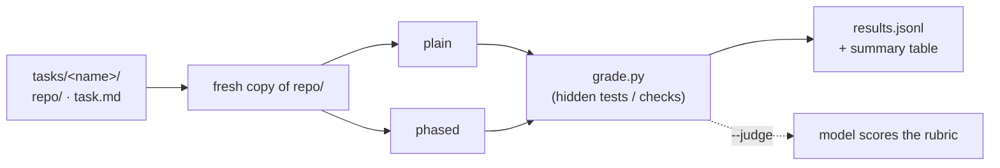

# Benchmarks: `tai agent` with and without phased work

Runs the same tasks through `tai agent`'s loop in two modes on your Tiiny device, then grades the results:

- **plain**: one prompt, one conversation, as you would type it. It compacts at 85% and gets up to two "continue" nudges if it hits the step limit.
- **phased**: the same prompt as the goal of `/phase start`. It runs explore → plan → the phases the plan defines, each with a fresh context, with the gates answered "yes".



## Running

```sh
.venv/bin/python benchmarks/run.py --check                       # graders only: no device, ~10 s
.venv/bin/python benchmarks/run.py                               # all tasks, both modes, 1 run each
.venv/bin/python benchmarks/run.py -t ts-templates -n 3          # one task, 3 runs per mode
.venv/bin/python benchmarks/run.py --mode phased --judge         # phased only, plus the model judge
.venv/bin/python benchmarks/run.py -m Qwen3.6-35B-A3B-Turbo -m Qwen3.8-27B   # compare two models
.venv/bin/python benchmarks/run.py --report ~/.local/share/tai/bench/20261114-2130
.venv/bin/python benchmarks/run.py --quick -V lean -V checklist-lean -n 2   # quick suite, two variants
```

## Quick suite and variants (for iterating)

`--quick` runs six small tasks (`q-*`), a few minutes each on Qwen3.6-35B-A3B-Turbo, aimed at what went wrong in the full runs:

| task | checks | aimed at |
|---|---|---|
| `q-ts-scopes` | 10 hidden `node --test` tests | scope lookup (`../`, outer scopes), plain's ts-templates failures |
| `q-python-clock` | 12 hidden pytest tests | the clock seam and expiry, the python misses |
| `q-research-ferry` | 5 questions, sources, a short summary | corrected and unreliable figures, deliverables in the right place |
| `q-story-letter` | two chapters with rules | writing the deliverable before any scaffolding |
| `q-py-bulk` | 6 hidden pytest tests + own tests | a small feature that should fit an existing pattern (a discount rule): quality, for `review.py` |
| `q-py-pagefix` | 6 hidden pytest tests + a regression test that fails on the original | a minimal bug fix from a user report: quality, for `review.py` |

### Claude review (`review.py`)

Tests say whether a change works, not whether it is good code. `review.py` has Claude (Opus 5.5, through the Claude Agent SDK, which uses the Claude Code login: no API key) compare two variants' runs of the same task side by side, blind (`A`/`B` in random order), with read-only tools, on five points: task, focus, fit, readable, tests. Runs are paired by number. A choice between two is much less noisy than a score.

```sh
.venv/bin/pip install -e '.[bench]'
.venv/bin/python benchmarks/review.py ~/.local/share/tai/bench/<run> -V plain -V bare [-t q-py-bulk]
```

About $0.20–0.30 of usage per pair (counted against the subscription). Verdicts are appended to `review-<a>-vs-<b>.jsonl` in the run folder.

A **variant** says how the agent is run, so ideas can be compared side by side with `-V` (repeatable; results are grouped by the variant's name). Variants are JSON files in `benchmarks/variants/`, or any `.json` path:

```json
{"mode": "checklist",
 "extends": "lean",
 "prompt": "added to the system prompt",
 "prompt_by_domain": {"python": "added for python tasks", "typescript": "…"},
 "think": {"plan": true, "default": false},
 "stop_after": "plan"}
```

- **mode:** `plain` (one conversation), `checklist` (the task with "write a short checklist first", then a review turn that checks the work against it), or `phased`.
- **think:** thinking on or off per stage: a phase name (`explore`, `plan`, …), `work` or `review`, else `default`; unset keeps tai's setting.
- **extends:** start from another variant: its prompts come first, its mode and thinking apply unless overridden.
- **prompt_by_domain:** added to the system prompt for tasks of that `domain` (`task.json`), e.g. language idioms.
- **stop_after:** phased only: end after that phase, e.g. `plan-only` to test the early phases in a few minutes.
- **style:** `false` leaves out tai agent's working-style and code-shape rules (`STYLE` in `src/tai/agent/prompt.py`, on by default since 2026-11-16). Variants that carry their own working-style text set it, so their results stay comparable with runs from before.

Built in: `plain`, `phased`, `checklist`, `phased-think-plan` and `plan-only` run tai agent as it ships (with `STYLE`); `no-nudges` is plain with the loop's nudges off (`agent/nudges.py`); `scripted` is plain + "batch looking around and checking into one bash script that prints only what you need" (Code Mode lite: fewer model turns). `bare` is plain without `STYLE`: the `plain` of runs before 2026-11-16. Without `STYLE`: `lean` and `checklist-lean` (working-style rules: deliverables first, edit rather than rewrite, no helper tools, keep the project working), `lean-shape` (lean + code-shape rules: small functions, extract helpers, no copied logic, flat code, lookup tables; the same text as `STYLE`), `lean-idioms` (lean-shape + short Python/TypeScript idiom lists), `plain-structured` (bare + "Write well-structured code.") and `lean-check` (lean-shape + re-check the task's requirements before finishing, stop a fix loop after 3 failing test runs).

- **Time:** a run can take a long time: tens of minutes per task and mode on the device. `--timeout` (minutes, default 60; 0 = no limit) cancels a run that takes longer. The repo is still graded, but the score is for unfinished work: the run log says `timed out` and the summary counts such runs in its `timed out` column. Phased runs take several times longer than plain ones, so a tight limit hurts them most.
- **Results:** each run's repo, including phased work's `.tai/work/` folder, is kept under `~/.local/share/tai/bench/<time>/<task>/<mode>-<n>/` (with several `-m`, under `<time>/<model>/…`). Results are appended to `results.jsonl` as each run finishes, so an interrupted benchmark keeps what it has.
- **Transcript:** each run folder has `requests.jsonl`, one line per model call: the messages added since the previous call (`fresh: true` when the conversation was replaced, e.g. by a new phase or a compaction), the reply (text and tool calls), `usage`, the device's `timings` and the seconds it took. For example, `jq -r '[.n, .kind, .usage.completion_tokens, .seconds] | @tsv' requests.jsonl` shows where the time went.
- **Models:** the agent model is loaded if needed. Like `tai agent`, it asks before unloading other models (`-y` skips the question).
- **Settings:** the model and thinking settings are the same as `tai agent`'s (`default.agent`, `agent.think`), and `-m` picks another model (its name, or a part of it that matches only one model: `Qwen3.6` matches both Qwen3.6-35B-A3B and its Turbo). Repeat `-m` to compare models: each is loaded once and runs every task and mode before the next.

## Reading the summary

| column | meaning |
|---|---|
| score | mean share of the grader's checks passed (hidden tests for code; rules and answers for writing and research) |
| range | worst and best run |
| judge | mean rubric score 1–10 from `--judge` (writing and research only) |
| tokens | prompt + completion tokens over all requests. Prompt tokens are counted per request, so the cache is ignored |
| requests, minutes | model calls and wall-clock time |
| tok/s | writing speed (tokens written per second of writing, from the device's timings) |

A third table, **process**, shows how the runs worked (`benchmarks/process.py`): `health` (aihealth's score of the finished code; code tasks only), `overhead` (share of written tokens that didn't go into a deliverable, by the task's `deliverables` globs), `rewrites` (whole-file writes of a file already written), `strays` (files left behind that aren't deliverables), and the time to the first deliverable.

A second table, **written tokens by reply kind**, splits the tokens the model wrote by what each reply did: a tool call (`write`, `edit`, `bash`, `phase_done`, …) or plain `text`. Writing is the slow part on the device, so this shows where a run's time went.

Device output varies from run to run, so use `-n 3` or more before drawing conclusions. The judge is the same model that did the work: use it to compare the two modes, not as an absolute score.

## Tasks

| task | domain | what it measures |
|---|---|---|
| `python-inventory` | Python | Add expiring reservations across models, store, CLI and a clock seam. 17 hidden pytest tests, plus the project's own tests kept and extended. |
| `ts-templates` | TypeScript (Node, no deps) | Grow a variables-only template engine into if/each/partials with scopes, `../` paths, and errors with line numbers. 20 hidden `node --test` tests. |
| `research-rail` | research | 12 questions from 11 conflicting documents about a made-up railway, where corrections supersede earlier figures and an interview misleads. Graded on answers and cited files, plus a briefing (also judged). |
| `writing-story` | writing | A five-chapter story from a brief. The grader checks lengths, the required sentence, the compass, the cast and repeated sentences. The judge rates plot, consistency, the reveal, characters and prose. |

Each task folder holds:
- `task.md`: the prompt, given word for word to both modes;
- `task.json`: the domain, `suite` (`quick` for the `q-*` tasks), `deliverables` (globs of the files the task asks for, for the process metrics), `hidden_tests` (the denominator, so tests that fail to import still count) and an optional judge rubric;
- `repo/`: the starting project;
- `hidden/` (optional): tests installed only after the agent is done;
- `grade.py`: prints `{"passed", "total", "notes"}`, using helpers from `grading.py`;
- `solution/` or `make_solution.py`: a reference answer, so `--check` proves the grader gives it 100% and the untouched repo a low score.

## Safety

Nobody approves the agent's tool calls during a benchmark, so the harness limits them:
- **bash:** commands run under macOS `sandbox-exec`. They can write only inside the run folder, have no network, and can't read the tasks folder.
- **File tools:** read, grep, glob and ls refuse paths outside the run's repo. Writes outside it are denied.
- **Tools offered:** the built-in tools only: no web, MCP, media or skills, and plain mode doesn't get `start_phases`.
- **History:** nothing is saved to tai's history.

Grading runs the agent's code too, so it is sandboxed the same way.

## Adding a task

Create `tasks/<name>/` with the files above, keeping `repo/` small and the spec in `task.md` exact enough for hidden tests. Then run `--check`. `tests/test_benchmarks.py` runs `--check` for every task too.
