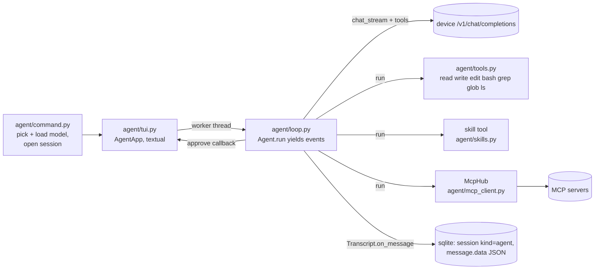

# agent

How `tai agent` (the coding agent with a full-screen TUI) is built, what it promises the user, and how to test it.

## Shape

- **command.py** creates the `Viewer` and the media tools (closing the viewer on exit). It does everything that may prompt or print in the normal terminal (model choice, `ensure_loaded` with its unload confirmation, MCP connection status) *before* the TUI starts, and closes the MCP hub after it exits. `AgentConfig.tools` = built-ins + `skill` + MCP tools. textual is imported lazily, so other `tai` commands don't pay for it.
- **loop.py** knows nothing about the UI. `Agent.run(text)` streams one turn: it rebuilds tool calls from streamed deltas (`_Accumulator`: id/name arrive first, `arguments` arrive in pieces by `index`), runs each call, appends a `tool` message per call, and repeats until a reply has no tool calls (or `max_steps` is reached: 200 by default, `agent.max_steps` sets it or `off`; never counted in phased work, where the context budget ends a phase; then the user types "continue"). It yields `TextDelta` / `ReasoningDelta` / `ToolStart` / `ToolEnd` / `TurnEnd`.
- **Nudges** (`agent/nudges.py`, `AgentConfig.nudges`, on by default): the loop steps in where prompt lines measured no effect. (1) A reply with no tool calls that ends by announcing work ("Let me start by exploring…") would end the turn with nothing done (seen in a benchmark run: 33% after 6 s). The loop sends `CONTINUE` instead, at most twice per turn, with a `Notice`. The pattern skips "Let me know…"; on all 117 final replies in the benchmark transcripts it flagged only that one real case. (2) Fix loops: the 4th failing run in a row of the same bash command (exit code ≠ 0, whitespace-normalised), and every 4th after, gets a note appended to its result that quotes the turn's task (2000 chars) and asks for a one-sentence diagnosis before one change. Benchmarks switch them off with `"nudges": false` (variant `no-nudges`). (3) Optional, off by default until measured (`AgentConfig.recheck`, variant `recheck`): when a turn that ran write/edit is about to end, the loop sends the task split into numbered requirements (`requirements`: each bullet and each sentence, headings dropped, max 30) and asks for "ok: where" or "missing: what" per item, then fixes. Once per turn. It targets explicit sentences lost to idioms (round per line, `clock.now()` through the module); a prompt line asking for the same (`lean-check`) measured nothing.
- **Prompt** is `PromptArea` (a `TextArea` subclass). Enter sends. Ctrl+J, Alt+Enter, or a `\` before the cursor + Enter inserts a newline; Shift+Enter works only in terminals that report it (most send a plain Enter). Pasted text keeps its newlines and isn't sent: a real paste reaches the App, which forwards it once to the focused widget, so tests must `app.post_message(events.Paste(...))`. Posting to the widget directly double-inserts. The box grows to `max-height: 12`.
- **Prompt history:** Up on the first line / Down on the last line walk through earlier prompts (`PromptHistory` in `agent/history.py`, pure state; Down past the newest brings back the unsent draft). Everything typed is kept, `/commands` included, per project folder in the `prompt_history` table (migration 4), with the latest 500 loaded at start. `tai agent --no-save` runs on `Store.private_copy()` (in memory, settings only): no session, messages or prompts are written, and past prompts aren't offered either. Consecutive repeats are stored once. The attribute is `PromptArea.prompts`: `TextArea.history` is textual's undo stack, and overriding it breaks every edit.
- **tui.py** runs `Agent.run` in a `@work(thread=True)` worker and receives events via `post_message`. `approve()` is called on the worker thread: it pushes `PermissionScreen` through `call_from_thread` and blocks on a `threading.Event` until the modal is dismissed.

## Promises (keep them true)

- Reads (read, grep, glob, ls, skill, read-only MCP tools) and `phase_done` never ask; neither do write/edit inside an active phase's work folder. **write/edit** (grant group `files`) and **bash** (group `bash`) ask first, showing a unified diff or the command. **web_search/web_fetch** (group `web`) ask too, showing the query or URL, since both send something off the machine. **start_phases** (group `phases`) asks before switching to phased work.
- "Always" (`a`) covers that group for the rest of the session (`Agent.granted`), **except** writes outside the project root (`Preview.outside`). Those ask every time, and the modal doesn't offer "always" for them.
- The modal's preview (`#perm-body`) gets its max height from the screen (`PermissionScreen._fit_body`, on mount and resize): 85% of the rows minus 8 rows of chrome, capped at 30, and it scrolls. A fixed 30 used to push the y/a/n line off the dialog in terminals under ~45 rows. `ConfirmScreen` is centred like it.
- A denied call is never run. The model is told `DENIED` and asked not to retry.
- Every `tool_call` gets a `tool` message, even when interrupted (`INTERRUPTED`). Otherwise the next request is malformed.
- Tool errors (`ToolError`, bad JSON, unknown tool) go back to the model as `Error: …` results. They never crash the turn. Device errors end the turn with `TurnEnd("error")`.
- Esc → `Agent.cancel()`: stops between stream chunks (the stream generator is closed, ending the HTTP request) and before each tool. Ctrl+C also releases a worker blocked on a permission prompt (the answer stays DENY).
- **Copy:** assistant text is a `MessageView` (textual's `Markdown` widget): Rich `Markdown` renderables in a `Static` can't be mouse-selected. `MessageView.set_source` re-applies the latest text after mount, because `Markdown` applies its constructor text on mount and would wipe deltas streamed before that. Don't override `_on_mount`: textual calls every class's `_on_mount` itself, so a `super()` call runs it twice. Ctrl+C (`action_copy_or_quit`) copies the prompt's selection or the screen selection and quits only when nothing is selected. `copy_to_clipboard` also runs `pbcopy` on macOS, since Terminal.app ignores OSC 52.

## When the agent's model gets swapped out

- The agent runs on the same NPU it can manage. A tool call like `tai -y image …` (through bash) can unload the agent's own model: the image model (23%) doesn't fit next to the coder (94%). This happened in a real session, where the model piped `echo Y` into the swap prompt. The system prompt now says to use `tai -y` and that it is reloaded automatically. It also tells the model to raise bash's 120 s `timeout` for slow commands (`tai 3d`: 900).
- Recovery (`Agent._stream_or_reload`): if a model request fails with a "not loaded" 404 (`model_missing()` matches the device's wordings), the loop yields a `Notice`, calls `Agent.reload_model` (installed by the TUI), and retries the step once. The TUI's `_reload_agent_model` runs `ModelLoader.ensure_loaded` with `TuiLoaderUI`, so unloading whatever is in the way asks in a modal and progress shows in the status line. Declining becomes a `TiinyError` telling the user to `/tiiny load <model>`.
- Status line: `_busy(label, detail)` shows `◐ label · detail · Ns`, re-rendered every second, for thinking, tool runs (e.g. a 60 s `tai image`), waiting for the user, loading, and `/tiiny`. The timer restarts only when the label changes. `_status(text)` is for idle states and ends the activity.

## /tiiny (`agent/device.py`)

- `DeviceCommands.run(line)` returns Markdown: `status` (device info, NPU, loaded models, CPU/memory/disk), `models`, `load <m>`, `unload <m|all>`, `restart`, `shutdown`, `help`. Device endpoints: `/api/v1/sys/status`, `/sys/device_info` (slow, ~1.5 s), `POST /sys/reboot/` and `/sys/shutdown/`.
- Asking goes through the same `LoaderUI` as model loading. In the TUI that's `TuiLoaderUI`: `ConfirmScreen` (y/n) via `AgentApp.wait_for_modal` (the same blocking helper tool permissions use), with progress in the status line. Restart and shutdown always ask. Unloading, or a load that would swap out, the agent's own model (`protect` = `config.model_id`) says so in the question.
- The command runs in its own worker (`group="device"`). While it runs, new prompts and further `/tiiny` commands are refused. `MUTATING` subcommands (load/unload/restart/shutdown) are refused while the agent is busy. Errors and `LoadCancelled` become notes in the log, never exceptions.

## Sessions

- Migration 3 added `session.kind` (`chat`/`agent`), `session.cwd`, and `message.data` (the full chat-completions message JSON, including tool calls and results). `message.content` keeps a text summary, so `tai history show` works.
- `tai agent -c` continues the latest agent session **in the current folder**; `-r ID` resumes any agent session. `tai chat -c` only ever picks chat sessions, and `tai chat -r` refuses agent sessions, and vice versa.
- Messages are saved from the worker thread, so `Store` opens sqlite with `check_same_thread=False`. The UI only writes (`/clear`) while the agent is idle.

## Model

- `App.agent_model`: chat models whose `supported` includes "Tool Use" (Qwen3-Coder-Next, Qwen3.6). Order: `-m`, then `tai config set default.agent …`, then a loaded one, then the cheapest.
- The system prompt (`prompt.py`) holds the working rules, `STYLE`, the environment, and the project's `AGENTS.md` or `CLAUDE.md` (first one found, truncated to 20k characters). `STYLE` (working style + code shape) is the benchmarks' lean-shape variant, chosen by measurement (2026-11-16, Turbo): highest scores and a third faster than without it on code tasks. A generic "write well-structured code" line and per-language idiom lists measured no effect, so don't add such lines without a benchmark run (`bare` vs `plain`).
- Code Mode (the model writes one program against a typed API of its tools, run in a sandbox; Cloudflare, Pydantic AI) is not built: tried as a prompt first (benchmark variant `scripted`, 2026-11-17), Turbo still read files one call at a time and wrote no batching scripts. Its n=3 speedup on ts (8.1 → 4.7 min) didn't hold over 5 more runs: one 58-min run where the scripts it did write were throwaway debug probes. Nothing from it went into `STYLE`. A `run_code` tool calling tai's tools over a pipe, with the same permission callback, would fit the loop; build it only once a task needs many web/MCP lookups and the model is shown to batch.
- Tool calling on the device uses standard OpenAI `tools` / `tool_calls` / `role: tool`. Verified on Qwen3-Coder-Next, and on Qwen3.8-27B with a single call (2026-11-09).
- Thinking: `--think/--no-think`, else the `agent.think` setting, else `think`, else the model's default (`AGENT_THINK_SETTINGS` in `command.py`, through `cli._think_extra`). Kept apart from chat because reasoning can push one agent step past the device's 10-minute request limit (504). Measured 2026-11-09 on three graded coding tasks: Qwen3.8-27B (52% NPU, thinks by default) without thinking solved all three in 12-48 s, like Qwen3-Coder-Next (94%) at 11-35 s, both ~17-22 tok/s; with thinking one task took 398 s instead of 12 s and another hit the 504 at ~10 min. So with Qwen3.8 as the agent model, set `agent.think off`.
- Progress while the model works: the loop asks for `return_progress` and yields `PromptProgress(done, total)` (uncached tokens only: `processed - cache` of `total - cache`) while the prompt is read, then `ToolCallProgress(name, chars)` for each tool-call delta, because a `write` streams the whole file as arguments before `ToolStart`. The status line shows `reading the prompt… · 50% of 2.0K new tokens` / `preparing write… · 4.1K chars`. Checked live on Qwen3.8 heretic; untested on Qwen3-Coder-Next (an unknown field is expected to be ignored).
- Context use: the device ends every streamed reply with a `usage` chunk (`choices: []`, prompt/completion tokens) without `stream_options`. The loop yields it as a `Usage` event; the status line shows `total / context_window tokens (N%)` (window from the catalog's `context_window`, `Model.context`), kept across idle and busy states and reset by `/clear`. A resumed session shows nothing until its first request. The window is fixed per model: the launch takes no options, and nothing in `/openapi.json` or `/v1/capabilities` sets it.
- `/think on|off` in the TUI switches it for the rest of the run by changing `agent.config.extra` (read on every request, so it applies from the next step, also mid-task); `/think` alone tells the current mode. Only for models whose `thinking.toggleable` is true (`AppInfo.can_think`). It doesn't change the `agent.think` setting.
- The title shows `thinking on/off` when one is set (built by `AgentApp._title`, updated by `/think`). The status line says `working…` while waiting for the model, and `thinking…` only once reasoning text actually streams in. It used to say `thinking…` all the time, which looked as if `agent.think off` was ignored. Checked live: with it off, Qwen3.8 sends no `reasoning_content`, even with the agent's prompt, tools and tool results.

## Testing

- `tests/test_agent_tools.py` tests the tools on a temporary folder (both the ripgrep and the pure-Python grep).
- `tests/test_agent_loop.py` drives the loop with a fake `chat_stream` that replays scripted chunks, including tool calls split across chunks.
- `tests/test_agent_tui.py` drives `AgentApp` headlessly with textual's pilot (`app.run_test()`, `pilot.press`), run via `asyncio.run` with no plugin. Wait for `not app.busy` / `isinstance(app.screen, PermissionScreen)` with a polling helper.
- A live run needs a person at the keyboard. Auto-approving agent actions from a script is blocked by the harness, and it should be.
