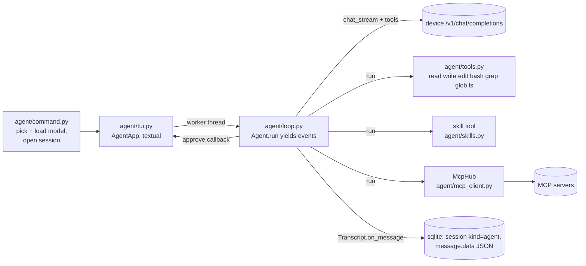

# agent

How `tai agent` (the coding agent with a full-screen TUI) is built, what it promises the user, and how to test it.

## Shape

- **command.py** creates the `Viewer` and the media tools (closing the viewer on exit). It does everything that may prompt or print in the normal terminal (model choice, `ensure_loaded` with its unload confirmation, MCP connection status) *before* the TUI starts, and closes the MCP hub after it exits. `AgentConfig.tools` = built-ins + `skill` + MCP tools. textual is imported lazily, so other `tai` commands don't pay for it.
- **loop.py** knows nothing about the UI. `Agent.run(text)` streams one turn: it rebuilds tool calls from streamed deltas (`_Accumulator`: id/name arrive first, `arguments` arrive in pieces by `index`), runs each call, appends a `tool` message per call, and repeats until a reply has no tool calls (or `max_steps` = 50 is reached). It yields `TextDelta` / `ReasoningDelta` / `ToolStart` / `ToolEnd` / `TurnEnd`.
- **Prompt** is `PromptArea` (a `TextArea` subclass). Enter sends. Ctrl+J, Alt+Enter, or a `\` before the cursor + Enter inserts a newline; Shift+Enter works only in terminals that report it (most send a plain Enter). Pasted text keeps its newlines and isn't sent: a real paste reaches the App, which forwards it once to the focused widget, so tests must `app.post_message(events.Paste(...))`. Posting to the widget directly double-inserts. The box grows to `max-height: 12`.
- **Prompt history:** Up on the first line / Down on the last line walk through earlier prompts (`PromptHistory` in `agent/history.py`, pure state; Down past the newest brings back the unsent draft). Everything typed is kept, `/commands` included, per project folder in the `prompt_history` table (migration 4), with the latest 500 loaded at start. `tai agent --no-save` runs on `Store.private_copy()` (in memory, settings only): no session, messages or prompts are written, and past prompts aren't offered either. Consecutive repeats are stored once. The attribute is `PromptArea.prompts`: `TextArea.history` is textual's undo stack, and overriding it breaks every edit.
- **tui.py** runs `Agent.run` in a `@work(thread=True)` worker and receives events via `post_message`. `approve()` is called on the worker thread: it pushes `PermissionScreen` through `call_from_thread` and blocks on a `threading.Event` until the modal is dismissed.

## Promises (keep them true)

- Reads (read, grep, glob, ls, skill, read-only MCP tools) never ask. **write/edit** (grant group `files`) and **bash** (group `bash`) ask first, showing a unified diff or the command.
- "Always" (`a`) covers that group for the rest of the session (`Agent.granted`), **except** writes outside the project root (`Preview.outside`). Those ask every time, and the modal doesn't offer "always" for them.
- A denied call is never run. The model is told `DENIED` and asked not to retry.
- Every `tool_call` gets a `tool` message, even when interrupted (`INTERRUPTED`). Otherwise the next request is malformed.
- Tool errors (`ToolError`, bad JSON, unknown tool) go back to the model as `Error: …` results. They never crash the turn. Device errors end the turn with `TurnEnd("error")`.
- Esc → `Agent.cancel()`: stops between stream chunks (the stream generator is closed, ending the HTTP request) and before each tool. Ctrl+C also releases a worker blocked on a permission prompt (the answer stays DENY).
- **Copy:** assistant text is a `MessageView` (textual's `Markdown` widget): Rich `Markdown` renderables in a `Static` can't be mouse-selected. `MessageView.set_source` re-applies the latest text after mount, because `Markdown` applies its constructor text on mount and would wipe deltas streamed before that. Don't override `_on_mount`: textual calls every class's `_on_mount` itself, so a `super()` call runs it twice. Ctrl+C (`action_copy_or_quit`) copies the prompt's selection or the screen selection and quits only when nothing is selected. `copy_to_clipboard` also runs `pbcopy` on macOS, since Terminal.app ignores OSC 52.

## MCP servers (`agent/mcp_client.py`)

- Config is in Claude Code's format: `{"mcpServers": {name: {command, args, env} | {type: "http", url, headers}}}`. `~/.config/tai/mcp.json` is read first, then the project's `.mcp.json`, and a project entry overrides a user one with the same name. `${VAR}` and `${VAR:-default}` expand from the environment. A relative command with a slash (`.venv/bin/aihealth`) is resolved against the project root; a bare name (`npx`) is looked up on PATH. `~/.claude.json` is deliberately not read.
- `McpHub` runs every session on one background asyncio loop (thread "mcp"). It connects in parallel with a 30 s timeout per server. A failed server gets `ServerState.error` and is skipped; it never stops the agent. Calls from the agent's worker thread go through `run_coroutine_threadsafe`, with a 600 s timeout.
- **A stdio server's stderr goes to `$TAI_HOME/logs/mcp-<name>.log`**, never the terminal, because it would garble the TUI.
- The SDK is `mcp` 2.x: snake_case fields (`input_schema`, `annotations.read_only_hint`, `is_error`, `next_cursor`, `server_info`), and `MCPServer` (formerly FastMCP). `MCPServer` hides exception text ("Error executing tool X").
- Tools are exposed as `mcp__<server>__<tool>` (sanitized to `[A-Za-z0-9_-]`, max 64 characters) with the server's full JSON schema (`Tool.schema`). Tools with `read_only_hint` never ask. All others ask, showing the arguments as JSON, and "always" covers that server (grant `mcp:<server>`). aihealth marks none of its tools read-only.
- Server `instructions` (up to 2k characters each) are appended to the system prompt.
- HTTP servers (`streamable_http_client` + `httpx2.AsyncClient(headers=…)`) are implemented but **not verified** against a real server. OAuth is not supported.
- `tai mcp` lists servers, tools and errors; `tai agent --no-mcp` skips MCP entirely.

## Skills (`agent/skills.py`)

- These are folders containing a `SKILL.md` with YAML frontmatter (`name`, `description`). Search order: project `.claude/skills/`, then `~/.claude/skills/`, then `~/.config/tai/skills/`. The first skill with a given name wins. Only `<dir>/<skill>/SKILL.md` counts: Claude's account-synced skills (`~/.claude/skills/synced/<id>/…`) are deliberately not found, because they rely on Claude-only tools.
- Progressive disclosure: the system prompt lists only names and descriptions (up to 400 characters each). The `skill` tool (enum of names, never asks) returns the body without its frontmatter, plus the skill's folder, so the model can `read` the files it references.
- The frontmatter parser is a small built-in one (no PyYAML): `key: value`, quotes, `>`/`|` blocks and indented continuation lines.
- In the TUI, `/skills` lists them and `/<name> [task]` sends "Use the `<name>` skill. [task]". `tai skills` lists them from the shell.

## Viewer and media tools (`agent/viewer.py`, `viewer.html`, `agent/media.py`)

- These are built-in tools, deliberately not MCP: the viewer shares session state with the agent, and `image` needs the in-process `ModelLoader` and the agent's auto-reload. An MCP wrapper could be added later for other agents.
- **`image`** (prompt, path?, size?, seed?, steps?, guidance_scale?, negative_prompt?, model?) loads the image model via `ModelLoader(protect=agent model)` with the TUI's `TuiLoaderUI`, so it asks only when something must be unloaded (e.g. the coder at 94%; nothing with Qwen3.6 at 47%). It saves `images/<slug>.png` inside the project, **never overwrites** (`free_path` adds `-2`…), so it needs no write permission, then shows the image. Without a UI it refuses. It always sends a seed (random unless given) and reports it in the result, because the device doesn't return the seed it used; same seed and settings give a byte-identical PNG.
- **`show`** (path | html | markdown | text, title?) presents an item; `kind_for` maps the suffix to image/audio/video/model3d/html/markdown/file. **`ask`** (question, choices?) blocks until answered in the browser (600 s timeout); Esc releases it (`Agent.on_cancel` → `Viewer.cancel_asks`). None of the three needs permission.
- **Server**: aiohttp on its own loop thread, `127.0.0.1` on a random port, URL `http://127.0.0.1:<port>/<token>/`. Routes are `/<token>/`, `/<token>/ws`, and `/<token>/file/<id>/<name>`, which serves only presented items. The WebSocket requires `Origin` == the viewer's own origin, which blocks other sites and sandboxed iframes (Origin `null`). The browser opens on the first item unless a viewer is already connected; `/view` opens it on demand. Protocol: server sends `hello{items}` / `item` / `answered`; client sends `answer{id,value}`.
- **Page**: the agent's HTML and Markdown (rendered by `marked` from jsDelivr) go into `<iframe sandbox="allow-scripts">` srcdoc. Each frame posts its body height back. 3D uses `<model-viewer>` from unpkg and only when WebGL is available, with a download link always shown. Every card renders through `safeRender`.
- Bugs found in a real browser (keep them fixed): one throwing renderer (model-viewer without WebGL) aborted the `hello` replay and hid every later card; `Object.assign(el, {dataset: …})` throws (`dataset` is read-only); `documentElement.scrollHeight` never shrinks below the frame height, so measure `body`.
- Tests: `tests/test_agent_viewer.py` runs the real server with an aiohttp client as the browser (token, origin, live push, replay, file serving, ask/cancel/timeout). `tests/test_agent_media.py` uses a fake device and viewer. The page itself was checked by hand in Chrome.

## When the agent's model gets swapped out

- The agent runs on the same NPU it can manage. A tool call like `tai -y image …` (through bash) can unload the agent's own model: the image model (23%) doesn't fit next to the coder (94%). This happened in a real session, where the model piped `echo Y` into the swap prompt. The system prompt now says to use `tai -y` and that it is reloaded automatically. It also tells the model to raise bash's 120 s `timeout` for slow commands (`tai 3d`: 900).
- Recovery (`Agent._stream_or_reload`): if a model request fails with a "not loaded" 404 (`model_missing()` matches the device's wordings), the loop yields a `Notice`, calls `Agent.reload_model` (installed by the TUI), and retries the step once. The TUI's `_reload_agent_model` runs `ModelLoader.ensure_loaded` with `TuiLoaderUI`, so unloading whatever is in the way asks in a modal and progress shows in the status line. Declining becomes a `TiinyError` telling the user to `/tiiny load <model>`.
- Status line: `_busy(label, detail)` shows `◐ label · detail · Ns`, re-rendered every second, for thinking, tool runs (e.g. a 60 s `tai image`), waiting for the user, loading, and `/tiiny`. The timer restarts only when the label changes. `_status(text)` is for idle states and ends the activity.

## /tiiny (`agent/device.py`)

- `DeviceCommands.run(line)` returns Markdown: `status` (device info, NPU, loaded models, CPU/memory/disk), `models`, `load <m>`, `unload <m|all>`, `restart`, `shutdown`, `help`. Device endpoints: `/api/v1/sys/status`, `/sys/device_info` (slow, ~1.5 s), `POST /sys/reboot/` and `/sys/shutdown/`.
- Asking goes through the same `LoaderUI` as model loading. In the TUI that's `TuiLoaderUI`: `ConfirmScreen` (y/n) via `AgentApp.wait_for_modal` (the same blocking helper tool permissions use), with progress in the status line. Restart and shutdown always ask. Unloading, or a load that would swap out, the agent's own model (`protect` = `config.model_id`) says so in the question.
- The command runs in its own worker (`group="device"`). While it runs, new prompts and further `/tiiny` commands are refused. `MUTATING` subcommands (load/unload/restart/shutdown) are refused while the agent is busy. Errors and `LoadCancelled` become notes in the log, never exceptions.

## Sessions

- Migration 3 added `session.kind` (`chat`/`agent`), `session.cwd`, and `message.data` (the full chat-completions message JSON, including tool calls and results). `message.content` keeps a text summary, so `tai history show` works.
- `tai agent -c` continues the latest agent session **in the current folder**; `-r ID` resumes any agent session. `tai chat -c` only ever picks chat sessions, and `tai chat -r` refuses agent sessions, and vice versa.
- Messages are saved from the worker thread, so `Store` opens sqlite with `check_same_thread=False`. The UI only writes (`/clear`) while the agent is idle.

## Model

- `App.agent_model`: chat models whose `supported` includes "Tool Use" (Qwen3-Coder-Next, Qwen3.6). Order: `-m`, then `tai config set default.agent …`, then a loaded one, then the cheapest.
- The system prompt (`prompt.py`) holds the working rules, the environment, and the project's `AGENTS.md` or `CLAUDE.md` (first one found, truncated to 20k characters).
- Tool calling on the device uses standard OpenAI `tools` / `tool_calls` / `role: tool`. Verified on Qwen3-Coder-Next.

## Testing

- `tests/test_agent_tools.py` tests the tools on a temporary folder (both the ripgrep and the pure-Python grep).
- `tests/test_agent_loop.py` drives the loop with a fake `chat_stream` that replays scripted chunks, including tool calls split across chunks.
- `tests/test_agent_tui.py` drives `AgentApp` headlessly with textual's pilot (`app.run_test()`, `pilot.press`), run via `asyncio.run` with no plugin. Wait for `not app.busy` / `isinstance(app.screen, PermissionScreen)` with a polling helper.
- A live run needs a person at the keyboard. Auto-approving agent actions from a script is blocked by the harness, and it should be.
