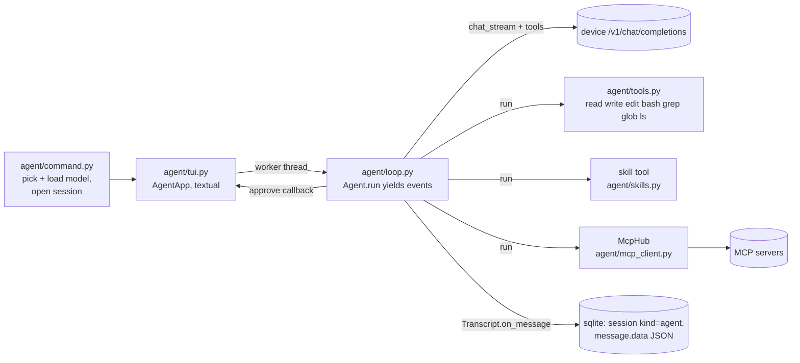

# agent

How `tai agent` (the coding agent with a full-screen TUI) is built, what it promises the user, and how to test it.

## Shape

- **command.py** does everything that may prompt or print in the normal terminal (model choice, `ensure_loaded` with its unload confirmation, MCP connection status) *before* the TUI starts, and closes the MCP hub after it exits. `AgentConfig.tools` = built-ins + `skill` + MCP tools. textual is imported lazily, so other `tai` commands don't pay for it.
- **loop.py** knows nothing about the UI. `Agent.run(text)` streams one turn: it rebuilds tool calls from streamed deltas (`_Accumulator`: id/name arrive first, `arguments` arrive in pieces by `index`), runs each call, appends a `tool` message per call, and repeats until a reply has no tool calls (or `max_steps` = 50 is reached). It yields `TextDelta` / `ReasoningDelta` / `ToolStart` / `ToolEnd` / `TurnEnd`.
- **tui.py** runs `Agent.run` in a `@work(thread=True)` worker and receives events via `post_message`. `approve()` is called on the worker thread: it pushes `PermissionScreen` through `call_from_thread` and blocks on a `threading.Event` until the modal is dismissed.

## Promises (keep them true)

- Reads (read, grep, glob, ls, skill, read-only MCP tools) never ask. **write/edit** (grant group `files`) and **bash** (group `bash`) ask first, showing a unified diff or the command.
- "Always" (`a`) covers that group for the rest of the session (`Agent.granted`), **except** writes outside the project root (`Preview.outside`). Those ask every time, and the modal doesn't offer "always" for them.
- A denied call is never run. The model is told `DENIED` and asked not to retry.
- Every `tool_call` gets a `tool` message, even when interrupted (`INTERRUPTED`). Otherwise the next request is malformed.
- Tool errors (`ToolError`, bad JSON, unknown tool) go back to the model as `Error: …` results. They never crash the turn. Device errors end the turn with `TurnEnd("error")`.
- Esc → `Agent.cancel()`: stops between stream chunks (the stream generator is closed, ending the HTTP request) and before each tool. Ctrl+C also releases a worker blocked on a permission prompt (the answer stays DENY).

## MCP servers (`agent/mcp_client.py`)

- Config is in Claude Code's format: `{"mcpServers": {name: {command, args, env} | {type: "http", url, headers}}}`. `~/.config/tai/mcp.json` is read first, then the project's `.mcp.json`, and a project entry overrides a user one with the same name. `${VAR}` and `${VAR:-default}` expand from the environment. A relative command with a slash (`.venv/bin/aihealth`) is resolved against the project root; a bare name (`npx`) is looked up on PATH. `~/.claude.json` is deliberately not read.
- `McpHub` runs every session on one background asyncio loop (thread "mcp"). It connects in parallel with a 30 s timeout per server. A failed server gets `ServerState.error` and is skipped; it never stops the agent. Calls from the agent's worker thread go through `run_coroutine_threadsafe`, with a 600 s timeout.
- **A stdio server's stderr goes to `$TAI_HOME/logs/mcp-<name>.log`**, never the terminal, because it would garble the TUI.
- The SDK is `mcp` 2.x: snake_case fields (`input_schema`, `annotations.read_only_hint`, `is_error`, `next_cursor`, `server_info`), and `MCPServer` (formerly FastMCP). `MCPServer` hides exception text ("Error executing tool X").
- Tools are exposed as `mcp__<server>__<tool>` (sanitized to `[A-Za-z0-9_-]`, max 64 characters) with the server's full JSON schema (`Tool.schema`). Tools with `read_only_hint` never ask. All others ask, showing the arguments as JSON, and "always" covers that server (grant `mcp:<server>`). aihealth marks none of its tools read-only.
- Server `instructions` (up to 2k characters each) are appended to the system prompt.
- HTTP servers (`streamable_http_client` + `httpx2.AsyncClient(headers=…)`) are implemented but **not verified** against a real server. OAuth is not supported.
- `tai mcp` lists servers, tools and errors; `tai agent --no-mcp` skips MCP entirely.

## Skills (`agent/skills.py`)

- These are folders containing a `SKILL.md` with YAML frontmatter (`name`, `description`). Search order: project `.claude/skills/`, then `~/.claude/skills/`, then `~/.config/tai/skills/`. The first skill with a given name wins. Only `<dir>/<skill>/SKILL.md` counts: Claude's account-synced skills (`~/.claude/skills/synced/<id>/…`) are deliberately not found, because they rely on Claude-only tools.
- Progressive disclosure: the system prompt lists only names and descriptions (up to 400 characters each). The `skill` tool (enum of names, never asks) returns the body without its frontmatter, plus the skill's folder, so the model can `read` the files it references.
- The frontmatter parser is a small built-in one (no PyYAML): `key: value`, quotes, `>`/`|` blocks and indented continuation lines.
- In the TUI, `/skills` lists them and `/<name> [task]` sends "Use the `<name>` skill. [task]". `tai skills` lists them from the shell.

## Sessions

- Migration 3 added `session.kind` (`chat`/`agent`), `session.cwd`, and `message.data` (the full chat-completions message JSON, including tool calls and results). `message.content` keeps a text summary, so `tai history show` works.
- `tai agent -c` continues the latest agent session **in the current folder**; `-r ID` resumes any agent session. `tai chat -c` only ever picks chat sessions, and `tai chat -r` refuses agent sessions, and vice versa.
- Messages are saved from the worker thread, so `Store` opens sqlite with `check_same_thread=False`. The UI only writes (`/clear`) while the agent is idle.

## Model

- `App.agent_model`: chat models whose `supported` includes "Tool Use" (Qwen3-Coder-Next, Qwen3.6). Order: `-m`, then `tai config set default.agent …`, then a loaded one, then the cheapest.
- The system prompt (`prompt.py`) holds the working rules, the environment, and the project's `AGENTS.md` or `CLAUDE.md` (first one found, truncated to 20k characters).
- Tool calling on the device uses standard OpenAI `tools` / `tool_calls` / `role: tool`. Verified on Qwen3-Coder-Next.

## Testing

- `tests/test_agent_tools.py` tests the tools on a temporary folder (both the ripgrep and the pure-Python grep).
- `tests/test_agent_loop.py` drives the loop with a fake `chat_stream` that replays scripted chunks, including tool calls split across chunks.
- `tests/test_agent_tui.py` drives `AgentApp` headlessly with textual's pilot (`app.run_test()`, `pilot.press`), run via `asyncio.run` with no plugin. Wait for `not app.busy` / `isinstance(app.screen, PermissionScreen)` with a polling helper.
- A live run needs a person at the keyboard. Auto-approving agent actions from a script is blocked by the harness, and it should be.
