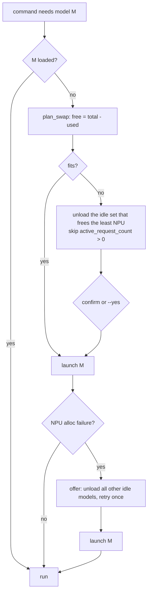

# npu-swapping

How `tai` decides which models to unload so the requested one can load, and the device failure modes that shape that logic.

## Facts about the device

- Only loaded models serve requests. Loaded models share an NPU budget, `npu_total` = 100.
- Each model has a fixed `npu_usage`, shown in `GET /api/v1/models/` even when it isn't loaded. On this device: Qwen3-Coder-Next 94, Qwen3.6-35B-A3B 47, Z-Image-Turbo 23, Qwen3-ASR 7, TRELLIS 6, OmniVoice 2, Qwen3-Embedding 1. The coder model can't share the NPU with much else; the other six fit together (86).
- **The percentages lie under fragmentation.** Loading the coder (94) with only 3% in use still failed with `Cannot allocate memory` / `ioctl ALLOC … failed` (container exit 134), and the device's `toast.message` said "Please unload all models and reload". Loading the big model first and the small ones afterwards works.
- A load takes about 5–60 s; the SSE stream reports progress.

## Algorithm (`src/tai/models.py: plan_swap`, `src/tai/cli.py: App.ensure_loaded`)

- Choosing victims (`_cheapest_victims`): among idle models, the combination that frees the **least total NPU** while still making room wins. Ties go to fewer models, then to the set whose newest member was used longest ago. Big models are expensive to reload (the coder takes about a minute), so they are kept over small ones regardless of recency. Example: 5% free and TRELLIS needs 6 → unload the embedding model (1), not the older coder (94).
- Search is exhaustive over combinations, which is trivial for the 7 models on the device. Above `MAX_EXACT` (16) idle models it falls back to a greedy smallest-first pass.
- Recency comes from `last_inference_time`, falling back to `use_time`, both from `/api/v1/models/running`.
- Busy models (`active_request_count > 0`) are never unloaded. If the target still can't fit, `ResolveError` names the busy models.
- Before unloading, the user is asked; `-y` / `TAI_YES=1` skips the prompt. The "unload all and retry" fallback asks again, separately, and also skips busy models. A running 3D job keeps TRELLIS busy, and unloading it would kill the job.
- `LoadFailed.memory` detects the allocation failure from the strings `allocate memory` / `ALLOC` in `startup_error`.

## Default model choice (`resolve` with no `-m`)

1. The user's `tai config set default.<task> <model>` (stored in the sqlite `setting` table).
2. Otherwise a loaded model for that task, the cheapest by NPU first.
3. Otherwise the cheapest installed model for the task. For chat that's Qwen3.6 (47) over the coder (94), which is also the only chat model with vision.
