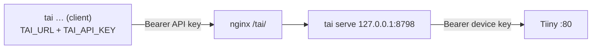

# serve

`tai serve` (`src/tai/serve.py`) lets other machines use the device through this one. A **client** is any `tai` with `--url` or `TAI_URL` set: `load_settings` then returns `Settings(via_server=True)` with the server URL as base and `TAI_API_KEY` as the Bearer token, so `TiinyClient` and every command (agent, loader, `/tiiny`, 3D…) work unchanged. **Standalone** (no URL) is the default and is also what the server itself uses (`load_settings(direct=True)` ignores TAI_URL).



## How the server works

- **Forwards only** paths starting `/v1/` or `/api/v1/` (all tai uses; that includes load/unload/shutdown, as in standalone use). Anything else, `/kb/*` for example, gets 404 without touching the device. `GET /healthz` needs no key.
- **Keys:** the caller's `Authorization: Bearer` must equal `TAI_API_KEY` (`hmac.compare_digest`). The request is then sent with the device key. `authorization`, `x-api-key` and hop-by-hop headers are dropped both ways, so neither key leaks across.
- **Streaming:** the request body is read whole (`client_max_size` 512 MB, for 3D images and audio). The response is streamed with `iter_any()`, so SSE chat and load progress stay live. `auto_decompress=False` keeps `Content-Encoding`/`Content-Length` valid. The device session has no read/total timeout: loads, 3D stages and long answers take minutes.
- **Client hang-ups** (tai stops reading at `[DONE]`, Ctrl+C, Esc) raise `ConnectionResetError` while writing. That is logged as "client disconnected", not as a device error; the response has already started, so no error can be sent then.
- **Two settings only:** the external URL lives in nginx and in the client's `TAI_URL` (e.g. `https://home.memention.net/tai`). The server knows just its port (`--port`, else `TAI_SERVE_PORT` from the environment or `./.env`, else 8765) and always binds 127.0.0.1.
- **Prefix:** never configured. `device_path` starts the route at the first `/api/v1/` or `/v1/` (checked in that order, since `/api/v1/` contains `/v1/`), so it doesn't matter whether nginx strips `/tai`. httpx joins a base URL with a path (`https://host/tai` + `/v1/x`), so TAI_URL can carry the prefix.
- One key (personal use). No request queue: the device's one-at-a-time limit is left to the user, as in standalone use. Settings and history stay on each client.

## nginx

```nginx
location /tai/ {
    proxy_pass http://127.0.0.1:8798;    # with or without stripping /tai
    proxy_buffering off;                 # stream chat tokens as they come
    proxy_read_timeout 3600s;            # model loads, 3D stages
    proxy_send_timeout 3600s;
    client_max_body_size 512m;
}
```

Run `tai serve --new-key` once, and put that key in `TAI_API_KEY` on the server and every client. nginx should terminate TLS, so the key is never sent in clear text.
